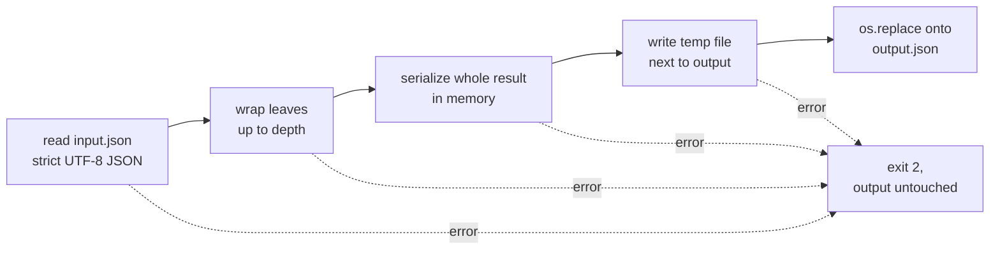

# Annotate JSON object values with their Python types

A small Python command-line tool, written as a coding exercise, that walks the nested objects of a JSON document and replaces each leaf value with an object holding the original value and its Python type name. It is handy for eyeballing what types a payload really carries once Python has parsed it, for example telling `1` from `1.0` or `"1"`.

It does not rename fields, infer a schema or flatten nested data. The type names are **Python class strings** such as `<class 'int'>`, not JSON Schema type names.

## Setup

Python 3.12 or newer (3.13 is pinned in `.python-version`). The tool itself uses only the standard library.

```sh
python3 -m venv .venv
. .venv/bin/activate
pip install .            # or: pip install -e ".[dev]" for the test and lint tools
```

This installs a `substitute` command. Running the file directly, `python3 substitute.py ...`, works the same without installing anything.

## Usage

Given `sample.json`:

```json
{"name": "Sample", "tags": ["a", "b"], "address": {"city": "Example", "zip": null}}
```

```sh
substitute sample.json result.json
```

writes `result.json`:

```json
{
  "name": {
    "_content": "Sample",
    "_type": "<class 'str'>"
  },
  "tags": {
    "_content": [
      "a",
      "b"
    ],
    "_type": "<class 'list'>"
  },
  "address": {
    "city": {
      "_content": "Example",
      "_type": "<class 'str'>"
    },
    "zip": {
      "_content": null,
      "_type": "<class 'NoneType'>"
    }
  }
}
```

### Limiting the depth

`--depth N` only wraps leaves in the first `N` levels of objects. Deeper objects are copied through unchanged:

```sh
substitute --depth 1 sample.json shallow.json
```

```json
{
  "name": {
    "_content": "Sample",
    "_type": "<class 'str'>"
  },
  "tags": {
    "_content": [
      "a",
      "b"
    ],
    "_type": "<class 'list'>"
  },
  "address": {
    "city": "Example",
    "zip": null
  }
}
```

| Depth | Effect |
| --- | --- |
| Omitted | Visit all nested objects |
| `0` | Leave the object unchanged |
| `1` | Wrap only the leaves of the root object |
| `2` | Also wrap leaves in directly nested objects |

The exercise's original argument order, with the depth between input and output (`substitute sample.json 1 shallow.json`), still works and gives identical output. Giving the depth both ways at once is an error.

`substitute --help` prints the options and these examples. `examples/input.json` and `examples/output.json` are the exercise's sample document and its full-depth result; a test checks that the stored output matches a fresh run.

### Errors

Every failure exits with status 2 and a one-line message, and leaves any existing output file untouched:

```console
$ substitute bad.json result.json          # bad.json holds {"price": NaN}
substitute: bad.json: NaN is not valid JSON
$ substitute missing.json result.json
substitute: [Errno 2] No such file or directory: 'missing.json'
$ substitute --depth -1 sample.json result.json
usage: substitute [-h] [--depth N] input.json [N] output.json
substitute: error: argument -d/--depth: must be a nonnegative integer, not '-1'
```

The root of the document must be an object. Malformed JSON, invalid UTF-8 and documents nested too deeply for Python's recursion limit are reported the same way.

## Use it from Python

```python
from substitute import substitution

record = {"enabled": True, "nested": {"count": 2}}
result = substitution(record, depth=1)
# {'enabled': {'_content': True, '_type': "<class 'bool'>"}, 'nested': {'count': 2}}
assert result is record  # the dictionary is modified in place and returned
```

`depth` must be `None` or a nonnegative `int` (not `bool`), otherwise `ValueError` is raised. A non-dict root raises `TypeError`. Keys are not inspected, so Python callers may use non-string keys.

## How it behaves



- **Lists are leaves.** `{"items": [{"id": 1}]}` becomes `{"items": {"_content": [{"id": 1}], "_type": "<class 'list'>"}}`; objects inside a list are not visited. Empty objects stay empty.
- **Strict JSON.** `NaN`, `Infinity` and `-Infinity` are rejected. Python's parser accepts them by default, but writing them back out would produce a file other JSON parsers refuse. A leading UTF-8 byte-order mark is accepted.
- **Safe overwrite.** The result is serialized before the output is touched, written to a temporary file in the same directory and moved into place with `os.replace`. A failure at any point leaves the previous output intact. An existing output keeps its permissions, a symlinked output updates the link's target, and the output may be the input file itself.
- **Output format.** UTF-8 (non-ASCII text is written as-is, not `\u` escaped), two-space indentation, final newline.
- **Not idempotent.** Running it on its own output wraps the `_content` and `_type` fields again.
- **Small documents.** The whole document is held in memory and traversal is recursive, so nesting is limited to roughly Python's recursion limit (about 1000 levels). This is not a streaming transformer for large datasets.

## Development

```sh
pip install -e ".[dev]"
python -m pytest        # unit, CLI and hypothesis property tests
ruff check .
ruff format --check .
```

The tests live in `tests/`: `test_substitution.py` covers the function, `test_cli.py` the command (including overwrite protection and error paths), and `test_properties.py` uses hypothesis to check, for generated JSON objects, that unwrapping a result gives back the input and that every result round-trips through strict JSON.

## License

MIT, see [LICENSE](LICENSE).
